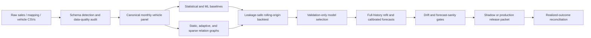

# AutoGraphFM

[](https://github.com/xinyushu766-art/AutoGraphFM/actions/workflows/ci.yml)
[](https://www.python.org/)
[](docs/REPRODUCIBILITY.md)
[](LICENSE)
[](CHANGELOG.md)

[中文说明](README_zh-CN.md)

**AutoGraphFM** is an auditable machine-learning system for automotive demand forecasting. It turns messy bilingual CSV data into a leakage-safe monthly vehicle panel, benchmarks statistical and deep time-series models, learns controlled vehicle-relation graphs, produces calibrated forecasts, and blocks release when evidence or monitoring gates fail.

The project is designed around one rule: **a more complex model is not promoted unless it survives temporal baselines, identity/permuted graph controls, multi-seed evaluation, and paired bootstrap testing.**

## Portfolio highlights

- Built an end-to-end pipeline from bilingual CSV ingestion and data-quality auditing to rolling backtests, graph learning, forecast intervals, drift monitoring, release governance, and outcome feedback.
- Implemented classical forecasting, Ridge residual learners, NLinear/DLinear-inspired challengers, GRU models, regime-aware mixtures of experts, and stability-selected sparse graph learning.
- Maintained **108 automated tests** across data, database, forecasting, graph, monitoring, governance, and reporting modules.
- On public China automotive aggregate data (2018–2024), literature-informed challengers improved **4 of 6** target/horizon cells; the largest relative WAPE improvement was **9.81%** for three-month EV forecasting.
- On a controlled known-graph benchmark, stability selection achieved **83.3% Precision@K** and **1.00 cross-seed edge Jaccard**.
- Preserved a strict `NO-CLAIM` boundary: controlled graph recovery is not presented as proof of real vehicle-level graph superiority.

## System architecture



## Evidence summary

### Public real aggregate benchmark

| Target | Horizon | Stage 10A WAPE | Literature-informed WAPE | Relative change |
|---|---:|---:|---:|---:|
| EV sales | 1 month | 19.55% | **18.82%** | **+3.72%** |
| EV sales | 3 months | 27.49% | **24.80%** | **+9.81%** |
| EV sales | 6 months | 29.76% | 29.76% | 0.00% |
| Total market | 1 month | **14.26%** | 14.90% | -4.47% |
| Total market | 3 months | 16.11% | **15.63%** | **+2.96%** |
| Total market | 6 months | 16.68% | **16.43%** | **+1.46%** |

### Controlled graph validation

| Metric | Result |
|---|---:|
| Candidate-edge Precision@K | **83.3%** |
| Candidate-edge Recall@K | **83.3%** |
| Final cross-seed edge Jaccard | **1.00** |
| Vehicle-demo graph research claim | `NO-CLAIM` |

Detailed evidence is retained in [`reports/`](reports/README.md).

## Quick start

```bash
git clone https://github.com/xinyushu766-art/AutoGraphFM.git
cd AutoGraphFM
python -m venv .venv
source .venv/bin/activate  # Windows: .venv\Scripts\activate
python -m pip install --upgrade pip
python -m pip install -e ".[dev]"
```

Run the full automated test suite:

```bash
pytest -q
```

Run the bundled public aggregate benchmark:

```bash
python scripts/run_stage10b.py \
  --output-dir outputs/stage10b_real \
  --overwrite
```

Run the stability-selected graph acceptance workflow:

```bash
python scripts/validate_stage12a.py --overwrite --full
```

For PostgreSQL-backed ingestion and immutable snapshots:

```bash
cp .env.example .env
python -m pip install -e ".[dev,postgres,snapshot]"
docker compose up -d postgres
python scripts/init_database.py
```

## Machine-learning stack

| Layer | Implemented methods |
|---|---|
| Baselines | Last value, seasonal naive, moving averages, drift, damped trend |
| Supervised ML | Autoregressive Ridge, seasonal-residual Ridge, NLinear/DLinear-inspired Ridge |
| Deep temporal | Temporal GRU, residual GRU, early stopping, multi-seed evaluation |
| Ensembles | Robust ensemble, regime-aware error mixture of experts |
| Graph ML | Static graph GRU, AGCRN-style adjacency, MTGNN-style directed Top-K graph, sparse residual graph, stability-selected consensus graph |
| Uncertainty | Empirical 80%/95% intervals and outcome coverage checks |
| MLOps | Drift monitoring, evidence scope, release gates, checksums, champion health and rollback actions |

## Repository layout

```text
src/autogfm/        Core Python package
scripts/            Reproducible command-line workflows
migrations/         Alembic database migrations
tests/              108 automated tests
data/                Small redistributable aggregate benchmark only
reports/             Curated real-market and graph-validation evidence
docs/                Architecture, methodology, reproducibility, and limitations
```

## Data and claim boundaries

- The repository includes only a small aggregate benchmark that can be redistributed with attribution.
- The external 38,806-row vehicle-level source file is **not** bundled.
- Demo vehicle rankings validate engineering paths only.
- Graph contribution remains `NO-CLAIM` until a complete real vehicle panel beats temporal, static, identity, and permuted controls on held-out periods.
- Predictive relationships are not described as causal effects.

See [`docs/CLAIMS_AND_LIMITATIONS.md`](docs/CLAIMS_AND_LIMITATIONS.md) and [`THIRD_PARTY_NOTICES.md`](THIRD_PARTY_NOTICES.md).

## Documentation

- [Architecture](docs/ARCHITECTURE.md)
- [Machine-learning methodology](docs/ML_METHODS.md)
- [Results and evidence scopes](docs/RESULTS.md)
- [Reproducibility](docs/REPRODUCIBILITY.md)
- [Public release validation](docs/PUBLIC_RELEASE_VALIDATION.md)
- [Data sources](docs/DATA_SOURCES.md)
- [Claims and limitations](docs/CLAIMS_AND_LIMITATIONS.md)
- [Interview guide](docs/INTERVIEW_GUIDE.md)
- [Resume bullet options](docs/RESUME_BULLETS.md)
- [GitHub upload guide](docs/GITHUB_UPLOAD_GUIDE_zh-CN.md)
- [GitHub release notes](docs/GITHUB_RELEASE_NOTES_v0.18.0.md)

## Author

**Xinyu Shu（舒新宇）** — [@xinyushu766-art](https://github.com/xinyushu766-art)

## License

The source code is released under the [MIT License](LICENSE). External datasets retain their original licenses and terms.
