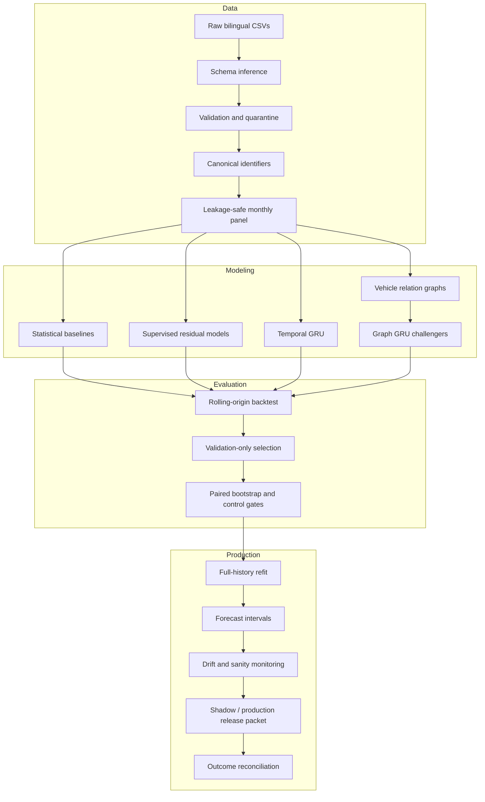

# Architecture

AutoGraphFM separates data engineering, model evaluation, graph learning, and deployment governance so that each layer can be tested independently.

## Key modules

| Package | Responsibility |
|---|---|
| `autogfm.realdata` | Canonicalization, lifecycle cohorts, and fixed-node panels |
| `autogfm.forecasting` | Baselines, rolling backtests, literature-inspired challengers, and production forecasts |
| `autogfm.graph` | Static, adaptive, sparse residual, and stability-selected graphs |
| `autogfm.models` | Temporal and graph residual GRU models |
| `autogfm.monitoring` | Distribution drift, missingness, forecast sanity, and outcome health |
| `autogfm.governance` | Evidence scopes and governed release packets |
| `autogfm.database` | SQLAlchemy repositories, constraints, and audit records |

## Design principles

1. **Time first:** features, graph candidates, and model selection use only information available before the forecast origin.
2. **Baselines before complexity:** graph and deep models must beat simple temporal controls.
3. **Falsification:** identity and permuted graphs detect gains caused by parameter count or generic message passing.
4. **Evidence scopes:** synthetic, demo, public aggregate, and user vehicle data cannot be mixed in one claim.
5. **No silent fallback:** invalid inputs and release blockers are explicit artifacts.
