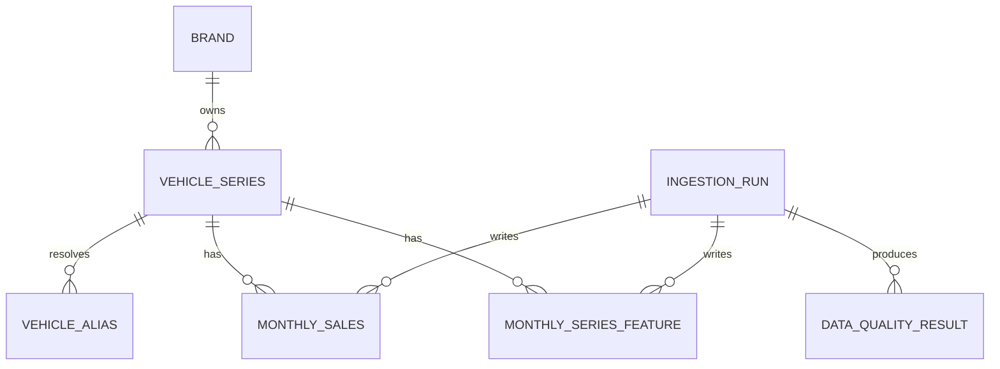

# Stage 1.0A: PostgreSQL Data Foundation

## 1. Why a database is required

Automotive demand data contains stable entities and repeated facts:

- brands;
- canonical vehicle series;
- source-specific aliases;
- monthly sales;
- prices, ratings, reviews, and popularity;
- ingestion jobs and quality results.

A collection of unrelated CSV files cannot reliably enforce identity, foreign
keys, uniqueness, provenance, or data-version rules.

## 2. Why training does not query PostgreSQL per batch

PostgreSQL is the authoritative operational store. Training will later use a
versioned Parquet snapshot:

```text
PostgreSQL
    │
    ├─ canonical entities
    ├─ audited monthly facts
    └─ versioned dynamic features
          │
          ▼
Snapshot builder
          │
          ▼
train.parquet / validation.parquet / test.parquet
```

This separates mutable data ingestion from reproducible machine-learning
experiments.

## 3. Forecasting entity grain

The graph node is a vehicle series:

```text
Brand
  └── VehicleSeries  ← forecast node
```

Individual trims are deferred because public monthly sales are commonly
reported at the series level.

## 4. Core relationships



## 5. Business keys

Monthly sales uniqueness:

```text
series_id + month + source + data_version
```

Monthly feature uniqueness:

```text
series_id + month + source + feature_version
```

These keys preserve multiple sources and corrected data versions without silent
overwrites.

## 6. Month representation

All months use the first day:

```text
2025-07-01
```

The rule is enforced in:

1. Pydantic input contracts;
2. database check constraints;
3. raw-record quality checks.

## 7. Entity normalization

Source strings such as:

```text
秦 PLUS
秦ＰＬＵＳ
秦-PLUS
```

are normalized before lookup. Normalization is deterministic, but automatic
fuzzy matching is not yet trusted. Ambiguous mappings will later use pending
review status.

## 8. Alembic

The initial migration creates seven tables and supports:

```cmd
alembic upgrade head
alembic downgrade base
```

Future schema changes must create new revisions rather than editing the initial
migration after shared use begins.

## 9. Stage 1.0A acceptance criteria

- seven tables are registered;
- initial migration upgrades and downgrades;
- foreign keys and uniqueness constraints work;
- negative sales are rejected;
- non-month-start dates are rejected;
- aliases resolve to canonical vehicle series;
- seed import is idempotent;
- Docker PostgreSQL can pass a healthcheck.
